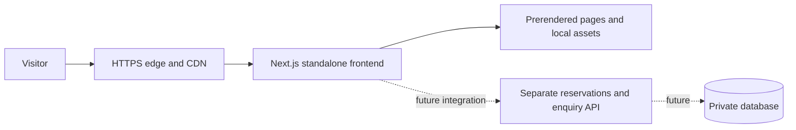

# Meridian Drive Hotel verification and release readiness

Audit date: 26 October 2026. Scope: the seven-page website preview and its Node.js production build. This audit does not certify WCAG conformance or approve a public hotel launch.

## Release decision

The application can be reviewed as a local design preview. Public launch remains blocked by unverified hotel content, demo-only submissions and bookings, missing operating policies, and unverified hosting/monitoring. Keep the existing noindex directives until those requirements are resolved.

The final automated results are recorded in [audit-summary.json](audit-summary.json). Raw browser, screenshot, HTTP-header, dependency, and Lighthouse evidence is saved locally in `qa/`. That directory is deliberately excluded from Git; rerun the audit commands to regenerate it.

## Accessibility findings and fixes

| Finding | Severity | Fix |
| --- | --- | --- |
| Small decorative room and amenity numbers had contrast near 3.84:1 and 3.85:1 | Serious accessibility issue | Darkened the text to the accessible muted color; decorative room indices are also hidden from screen readers |
| Rooms page skipped from the page heading to level-three room headings | Moderate accessibility issue | RoomCard now accepts `headingLevel`; the full collection uses h2 and homepage cards retain h3 |
| Skip link scrolled but did not move keyboard focus to main | Serious keyboard issue | Made main programmatically focusable with `tabIndex=-1`, including loading/error/not-found states |
| Accessible names omitted visible text on room actions and the desktop hero scroll link | Serious accessibility issue | Included the complete visible label within each accessible name |
| Native modal Tab cycling did not consistently retain focus | Serious keyboard issue | Added a shared Modal component with explicit forward/backward Tab wrapping, while preserving native Escape and focus restoration |
| Error-summary links were too small and close together | Serious target-size issue | Made each error link a distinct target at least 44px high |
| Small navigation, footer, and form targets; undersized mobile inputs | Usability issue | Increased target heights, consent-control spacing, and mobile text-input sizes |

Automated coverage includes WCAG 2 A/AA, WCAG 2.1 A/AA, WCAG 2.2 AA rules supported by axe, and best-practice rules. The browser audit visits all seven pages at 1440×1000, 390×844, and 320×800, checks headings, image loads, horizontal overflow, and JavaScript errors, and exercises nine interaction scenarios. Dynamic accessibility scans also cover the open menu, room dialog, gallery lightbox, empty room collection, form errors, and booking completion.

These checks cannot establish complete WCAG compliance. Screen-reader testing with NVDA/VoiceOver, physical iOS/Android testing, Safari/Firefox coverage, Windows high-contrast/forced-colors review, and manual contrast checks over all photographic regions remain release gates. Desktop and mobile screenshots are available in `qa/` for visual review.

## Performance method and limits

Lighthouse 13.5.0 runs mobile audits against the production standalone server, using its default simulated mobile/network/CPU profile. Each page receives a single recorded run. The results are local laboratory samples, not field Core Web Vitals, an uptime test, or a load test. No measured INP or real-user percentile is claimed. Total Blocking Time is a laboratory metric.

The initial homepage run measured performance 93, accessibility 96, best practices 96, LCP about 3.2 seconds, and CLS 0. Corrections include high fetch priority for the above-the-fold image, responsive optimization of the supplied logo, a valid favicon, removal of deprecated image `priority` use, and bounded image-source optimization. Supporting images remain lazy-loaded; fonts are local; most pages remain prerendered. Booking is intentionally request-rendered to accept query-prefilled selections.

The performance audit command fails if any measured page scores below 90. Review LCP and other metrics as well as the aggregate score; a score above 90 does not mean every Core Web Vital threshold is met. Next.js runtime/polyfill JavaScript may still appear in Lighthouse's unused/legacy JavaScript diagnostics; it was not removed in a way that would compromise framework compatibility.

SEO scores are deliberately reduced by the preview's `noindex, nofollow` header and metadata. Removing those to improve a score would expose unfinished demo content to indexing. Canonical URLs, sitemap entries, a social preview image, and verified Hotel structured data need the final domain and actual hotel details before launch.

## Security review

The current app contains no authentication, account system, database, upload handler, payment processor, Server Action, or live submission API. Those absent systems have not been security-tested. The health route only returns process/application availability and preview mode, not dependency health or secret configuration.

| Finding | Severity | Status and realistic scenario |
| --- | --- | --- |
| Demo forms could submit a native GET before hydration or without JavaScript | Medium privacy issue | Fixed with PreviewForm: controls and submit buttons stay disabled until local handlers are mounted. This prevents a visitor's contact message/email entering the URL, server access logs, or browser history through native form submission. Tested with JavaScript disabled |
| Missing CSP defense in depth | Medium hardening gap | Added same-origin resource policy, object blocking, base/form restrictions, and frame-ancestor denial. External injected resource loads are restricted |
| CSP retains `unsafe-inline` for scripts/styles | Medium residual defense-in-depth limitation | Required by this static App Router bootstrap/style approach. This policy does not stop arbitrary inline XSS if a future injection sink is introduced. No `dangerouslySetInnerHTML`, eval, or user-controlled HTML sink was found. Consider a nonce/hash strategy before adding user-authored HTML or third-party scripts; per-request nonces change static caching/rendering behavior |
| Broad local image optimizer scope and default resource limits | Low resource-hardening gap | Restricted to `/images/**` without source query strings, allowed no remote origins, disabled redirects, and limited source response bodies to 5 MB. Tests reject external, non-image-route, cache-busting-source, and invalid-size requests |
| Floating dependency specifications | Low reproducibility issue | Replaced `latest` specifications with installed exact versions and retained the npm lockfile; CI uses `npm ci` |
| Font redistribution notices absent | Low release-packaging issue | Added the official OFL license files for both bundled font families |

Final dependency audit covers production and development packages. The authoritative count is in `audit-summary.json`; zero reported advisories is a point-in-time npm database result, not proof that the software has no vulnerabilities.

Production HTTP tests verify CSP, anti-framing, nosniff, referrer policy, preview noindex, HSTS configuration, absence of the framework-identification header, no unexpected cookies, private/no-store booking responses, image caching, favicon, and health. HSTS enforcement and HTTPS redirects cannot be verified over local HTTP; validate both at the real edge. HSTS deliberately excludes unrelated subdomains and preload enrollment.

## Deployment architecture

Use a managed Node.js host or the supplied standalone container behind an HTTPS reverse proxy/CDN. Prerendered pages and immutable framework chunks can be cached; keep booking query responses private. Public image filenames currently have a one-day cache lifetime; version or rename replacement files rather than relying on immediate cache invalidation.

No backend is needed for this preview. When real submissions and reservations are implemented, deploy that service separately and require authoritative validation, rate limits/abuse controls, private secrets, authorization for administration, CSRF protection where cookie authentication applies, inventory concurrency controls, idempotent reservation/payment operations, retention rules, encrypted backups, and tested restores. Client validation is not an API security control.

Use Node.js 24 LTS for deployment, as selected by `.nvmrc`, CI, and Docker. Local checks here ran on Node 26.10.0 and Chrome 155.0.8059.40; Node 24 execution remains a CI/container verification step. The audit tooling requires at least Node 22.19.

## CI and container status

`.github/workflows/verify.yml` runs a locked dependency install, vulnerability checks, TypeScript, validation tests, production build, route checks, HTTP security checks, browser accessibility/interaction checks, and Lighthouse. It starts a production server, retains evidence, and stops it afterward. Actions are pinned to verified commit references, repository permission is read-only, checkout credentials are not persisted, and execution has a timeout. The workflow performs verification only; it does not publish or deploy automatically.

`Dockerfile` uses a multi-stage Node 24 build, standalone output, an unprivileged runtime user, a health check, and only traced runtime files plus public/static assets. `.dockerignore` excludes local credentials, source-reference documents, raw photo folders, dependencies, and audit output. Docker is unavailable in this environment, so image build, runtime permissions under Docker, health-check execution, and container scanning remain unverified. GitHub-hosted workflow execution also remains unverified.

Prefer a simple managed service over Kubernetes at this stage. If scaling later requires multiple Node instances, configure shared cache behavior and deployment coordination, measure memory/image-processing load, and load-test real reservation services before selecting orchestration.

## Release workflow and operations

1. Require the verification workflow to pass on the exact source revision. Run browser/performance checks on the hosted staging environment as well as localhost.
2. Build an immutable application version or container, scan it, and record its source revision and image digest. Deploy staging using production-like TLS, headers, cache behavior, and secrets handling.
3. Confirm domain ownership, certificate renewal, HTTPS redirects, HSTS behavior, security headers, and all route/asset URLs. Avoid static-only hosting for the current request-rendered booking route and image optimizer.
4. Configure `/api/health` process checks, a homepage synthetic check, error reporting, sanitized access/error logs, and alerts for availability, 5xx errors, latency, memory, and failed deployments. Never log contact messages or form contents. These monitoring services are not configured by this audit.
5. Promote with a health-gated rolling or blue/green deployment. Retain the previous artifact and rehearse rollback. No public deployment or rollback was performed here.
6. Recheck mobile performance, screen-reader/keyboard behavior, real contact/booking delivery when integrated, and alert routing after release.

## Public launch gates

- Confirm hotel address, official contact/social channels, room specifications/capacities, rates, taxes, amenity availability, team/history, and guest-review permission. Additional files under `Our rooms/` are present but have not been mapped/approved as final website assets during this audit.
- Replace illustrative photographs with approved property imagery and verify usage rights; obtain a sharper original logo when available.
- Connect real booking, enquiry, and newsletter services or explicitly approve a public informational-only scope. Verify delivery and failure recovery end to end.
- Publish privacy, retention/consent, booking, payment, and cancellation policies appropriate to the actual service.
- Complete the manual/cross-browser accessibility checks and hosted performance checks described above.
- Validate the CI/container/hosting path, monitoring, TLS, backup/restore requirements for any new backend, and rollback procedure.
- Configure the final canonical domain, sharing assets, sitemap and verified hotel data, then deliberately remove preview indexing blocks.

## References

- [Next.js production checklist](https://nextjs.org/docs/app/guides/production-checklist)
- [Next.js Content Security Policy guidance](https://nextjs.org/docs/app/guides/content-security-policy)
- [Next.js image configuration](https://nextjs.org/docs/app/api-reference/components/image)
- [Node.js release status](https://nodejs.org/en/about/previous-releases)
- Font licenses: `src/assets/fonts/cormorantgaramond-OFL.txt` and `src/assets/fonts/manrope-OFL.txt`.
